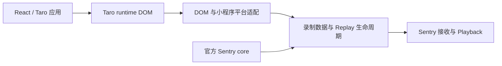

# 第二阶段设计原则

状态：设计决策已确认，2026-10-15。第二阶段先统一工具链，再开展官方 SDK、API 和运行时行为对齐；各项实现及验证状态见[第二阶段实施进度](./implementation/phase-two.md)。设计决定不等于实现或验收完成，第一阶段的固定候选包及原验收范围继续以[第一阶段记录](./implementation/phase-one.md)为准。

## 已明确的方向

- 第二阶段首先统一到 Vite Plus，由 `vp` 管理开发工具链及项目使用的 Node.js、pnpm，采用最新正式版本并固定可复现的版本组合。
- 公共 API 和内部功能以官方 Sentry 的设计及行为为参照。
- 利用 Taro runtime 的模拟 DOM 状态实现 Replay，同时正视微信小程序的平台差异和包尺寸约束。
- 工具链的最新版本与 Sentry 运行时的版本策略分别管理：Sentry 选择目标服务官方支持的大版本内最新稳定版；先宏观确定平台边界，避免反复逐项争论是否模拟浏览器。
- 正式支持范围以目标服务能够完成端到端验证的能力为准；服务端尚不支持的新能力明确列为未支持，不默认启用，也不以同名导出宣称支持。
- 默认行为以固定官方版本为起点，只根据明确的平台限制或实际测量引入有说明、可配置且有回归验证的差异。
- 发布产物采用 ESM 优先、自包含 CJS 兼容入口及独立 Worker，移除 UMD。

## 原则一：官方语义优先，平台适配有明确边界

官方对齐落实为三类可核查的契约：公共 API 的名称、参数和行为；内部采样、会话、缓冲、投递及隐私规则；Sentry 接收与 Playback 所依赖的数据协议。仅名称相同不足以声明兼容。

优先复用适合小程序环境的官方 `@sentry/core` 能力；对运行环境相关的采集、页面生命周期、网络及录制提供适配。内部模块组织可以围绕平台约束调整，但每项可观察的语义偏离应记录原因、影响及验证场景。官方 SDK 不具备的小程序扩展，应与通用 API 清楚区分。

平台架构先整体确定，具体公共 API 与默认行为在实施时依据固定版本做有针对性的契约验证。架构成立后，不为每个接口重新讨论小程序是否具有浏览器环境。

### 官方对齐基线

本阶段按目标自托管服务的兼容范围选择 v10 支持线。公开文档记录官方支持下限及 SDK 候选，实际部署身份、地址、构建标识和原始响应留在公开仓库之外。

| 官方 SDK | 自托管服务最低版本 | 本项目本轮结论     |
| -------- | ------------------ | ------------------ |
| v10      | 24.4.2             | 采用该支持线       |
| v11      | 26.4.2             | 不作为本轮升级目标 |

2026-10-15 查询到 `@sentry/core` 与 `@sentry/browser` 的 v10 最高稳定版本均为 **10.76.2**，作为第二阶段对齐基线，现已将运行时依赖升级并实现本地契约对齐。同一候选已通过宿主接入、开发者工具受控错误与 Replay 真实发送、双向关联及实际 Playback 验证，范围和校验值见[第二阶段实施进度](./implementation/phase-two.md)。其他功能、真机及上传体积仍需分别验收，不能将版本升级标记为全部能力验收完成。当前依赖以根 `package.json` 为准。

官方大版本支持下限不代表每项新功能都能在旧服务使用。例如现代结构化 Logs 到 self-hosted 25.9.0 才正式提供，不能由 SDK 具有 `logger` 导出来推断后端支持。Replay 的接收、关联和实际 Playback 也应分别验证。

本阶段正式支持范围以目标服务能够完成端到端验证的能力为准，暂不另外维护面向更新服务版本的功能验收分支。公共文档区分“正式支持”“未支持”“待验证”；直接重导出上游 API、通过类型检查或请求被接收，都不足以单独证明功能可用。是否收敛已有 beta 导出，作为公共 API 迁移的一部分处理并附迁移说明。

现有 `logger`、`metrics` 属于真实上游能力重导出，已有 core 与内存 transport 测试。上述支持策略不自动删除这些接口或测试；本阶段先明确其服务兼容要求、未支持状态及默认不开启策略。实现审计发现必须调整公开接口时，按已有 beta 迁移约定附说明，不能把本地能力测试当成服务端验收。

来源：[v10 固定版本兼容说明](https://github.com/getsentry/sentry-javascript/blob/10.76.2/MIGRATION.md)、[v11 固定版本兼容说明](https://github.com/getsentry/sentry-javascript/blob/11.7.0/MIGRATION.md)、[10.76.2 发布](https://github.com/getsentry/sentry-javascript/releases/tag/10.76.2)、[自托管 Logs 发布说明](https://github.com/getsentry/self-hosted/releases/tag/25.9.0)。

## 原则二：Taro DOM 是逻辑 UI 状态来源

宏观结论：本项目是面向 Taro 小程序的 Sentry 平台适配 SDK。Taro runtime 在小程序逻辑层实现 DOM/BOM 的一个子集，供 React/Vue 等框架驱动；本项目读取这一层的节点、属性、文本及变更，适配为 Sentry Replay 可消费的录制数据。

这层状态与 React 自身的虚拟 DOM、微信视图层的真实渲染状态需要分别命名。Taro 将逻辑树更新通过小程序渲染机制交给视图层，逻辑树可观察不代表原生组件内部、最终布局、计算样式及显示时序全部可观察。Canvas 等已有专用采集能力也应单独描述，不从 DOM 能力推导完整支持。

职责关系为：

现有实现已经是自有 recorder 读取节点和变更、产生 rrweb 兼容数据。官方浏览器 Replay 依赖浏览器录制基础设施，不能仅凭 Taro 有模拟 DOM 就认为它可以直接运行。Taro 官方说明也明确区分 React 已挂载到 Taro DOM 与 `setData` 完成、视图层显示。

依据：[Taro 官方实现细节](https://docs.taro.zone/docs/implement-note)、[Taro React 生命周期机制](https://docs.taro.zone/docs/react-overall)、[Taro DOM API](https://docs.taro.zone/docs/taro-dom)、[Taro 4.2.0 元素变更实现](https://github.com/NervJS/taro/blob/v4.2.0/packages/taro-runtime/src/dom/element.ts)、[本项目 recorder](../src/sdk/replay-poc.ts)。

采用“官方 core + 小程序适配 + 可选 Taro DOM Replay”：平台无关核心尽量复用，错误采集、网络、生命周期、存储和 Worker 由小程序适配层承担，Taro DOM 提供录制数据源。完整浏览器仿真不作为第二阶段路线，具体能力在这个边界内实施和验证，见[平台适配决策](./adr/0003-mini-program-platform-adaptation.md)。

## 原则三：以实际消费成本约束模块设计

错误监控可独立使用，Replay 及可选能力按需引入；使用 ESM 静态模块、准确的副作用声明和清晰的导出边界，使消费者能裁剪未使用能力，并以小程序生产构建验证结果。

本阶段选择 ESM 优先并保留 CJS。双格式发布可以让构建器选择 ESM；删除 CJS 不意味着原来两个格式都被打入应用，也不能直接等同于宿主体积收益。

当前代码有几个需要实测的边界：

- [SDK 入口](../src/sdk/index.ts)和 [polyfills](../src/sdk/polyfills.ts)存在导入时初始化，不能未经审计就全局声明 `sideEffects: false`。
- [Replay 门面](../src/replay.ts)只传递所需的五个 SDK 绑定；裁剪结果由真实生产模式的合成消费构建检查。
- [库构建配置](../config/pack.ts)承载 SDK/core/coordinator 及各公开入口的产物规则；从原根构建迁入 `vp pack` 或调整文件后缀，均不能单独证明功能边界已经可裁剪。
- [资源解码](../src/replay/replay-assets.ts)也使用 `fflate`。ESM 保留其包边界及官方副作用声明，错误监控消费者可裁剪它；启用 Replay 后主线程仍需资源解码，独立压缩 Worker 不等于主线程完全不含该依赖。CJS 与 Worker 继续自包含。
- Worker 是小程序需要的独立执行资产，其脚本格式依据 Worker 运行环境确定。

上述运行时结论与模块发布格式相互独立：没有浏览器环境不意味着不能消费 ESM，Taro 构建器可以将 ESM 编译为小程序产物。结合第一阶段保留原生宿主与 Taro 混合接入的既定范围，第二阶段以 ESM 作为构建器消费首选，同时保留自包含 CJS 兼容入口。

第二阶段移除 UMD。决策时 UMD 仅出现在构建配置、VM 产物自测及第一阶段历史记录中，README 接入、示例和隔离消费者未使用它，`exports` 也没有 UMD 子路径。删除 UMD 减少构建和发布维护，不直接等同于小程序主包变小，也不能由仓库无引用推断外部绝无消费者；产物变化须列入迁移说明，见[产物决策](./adr/0004-esm-cjs-worker-artifacts.md)。

合成消费者以同一生产构建基线比较三种消费场景：仅错误监控、错误监控加 Replay、再启用 Worker。记录 JS 和 Worker 的未压缩字节及实际参与输出的源模块，检查未启用能力是否仍进入产物。真实小程序主包/分包的增量和绝对预算，仍须由宿主构建及上传结果确定。npm tarball、磁盘文件、gzip 大小和小程序上传包不是同一计量口径。

小程序包尺寸预算应落到实际主包/分包规则。当前尚未核验[微信官方分包文档](https://developers.weixin.qq.com/miniprogram/dev/framework/subpackages.html)的具体限制和计量方式，生产消费基线须补齐这一项；npm 包整体小于 2M 不作为已确认要求。

参考：[Webpack tree shaking](https://webpack.js.org/guides/tree-shaking/)、[Rollup tree shaking](https://rollupjs.org/configuration-options/#treeshake)、[Taro 构建配置](https://docs.taro.zone/docs/config-detail)。

### 默认策略与资源预算

固定版本 10.76.2 的 Replay 默认最短发送时长为 4,999 毫秒，出错前缓冲窗口为 60 秒，单个 Replay 默认最长 60 分钟，session 无活动 5 分钟暂停，空闲 15 分钟会话过期。第二阶段已经按这些默认值拆分会话策略与 recorder 生命周期：空闲暂停保留身份，过期后重新采样；尚未发送的 error buffer 继续保持有界窗口，不套用 full-session 的空闲暂停。

已确定以目标官方 SDK 的行为和默认值为起点，仅在平台限制或真实小程序测量证明必要时引入有说明、可配置且有回归验证的差异。保留有界缓冲、投递队列及失败保护；浏览器端的内存上限须结合平台测量评估，现有 POC 默认值不自动成为长期约定。工具链迁移阶段保留了原默认值；后续运行时改动及行为变化已单列[迁移说明](./migrations/phase-two-runtime.md)。新增默认值仍须在目标服务与设备验证。

资源预算分别衡量：

- 下载包体积：生产构建中的代码、资源及 Worker，通过模块划分和裁剪优化。
- 运行时资源：录制缓冲、投递队列的内存，以及序列化、压缩的 CPU 开销，通过有界队列与测量约束。
- 网络和服务资源：采样、上传频率、分段字节及重试成本，通过采样、分段和压缩控制。

小程序包尺寸限制不能直接推导录制窗口或会话时长。延长缓冲时间不直接增加下载包体积，队列的字节上限也不是小程序安装包上限。

官方依据：[10.76.2 Replay 常量](https://github.com/getsentry/sentry-javascript/blob/10.76.2/packages/replay-internal/src/constants.ts)、[Integration 默认配置](https://github.com/getsentry/sentry-javascript/blob/10.76.2/packages/replay-internal/src/integration.ts)、[会话与空闲处理](https://github.com/getsentry/sentry-javascript/blob/10.76.2/packages/replay-internal/src/replay.ts)。当前实现：[协调器](../src/replay/coordinator/ReplayCoordinator.ts)、[投递队列](../src/replay/coordinator/delivery.ts)。这些比较尚不代表新默认值已在目标服务与设备验收。

## 工具链版本与迁移方向

“最新”按最新正式版本理解，预览版另行决定。工具版本按 Vite Plus 官方支持的整套组合升级并精确锁定；实施前重新查询，不能让安装时的浮动标签决定实际基线。

2026-10-15 核查快照：

| 项目      | 官方当前版本 / 说明                                                                                        |
| --------- | ---------------------------------------------------------------------------------------------------------- |
| Vite Plus | 1.2.0                                                                                                      |
| 内置工具  | Vite 8.3.4、Vitest 5.0.4、Oxlint 1.88.0、Oxfmt 0.73.0、Rolldown 1.2.13、tsdown 0.23.1                      |
| Node.js   | 采用 Current 26.12.0；最新 LTS 为 24.22.0，二者均满足本版 Vite Plus 要求                                   |
| pnpm      | 最新已发布稳定版 12.13.0，精确版本元数据可读取；本轮 registry 的 `latest` 标签仍返回 12.11.2，需要显式锁定 |

本项目发布 SDK，优先使用 `vp pack` 对应的库构建能力统一产物和声明，测试使用 `vp test`，lint/format 使用 `vp check` 等入口。`vp pack` 构建库与生成 npm tarball 是两个步骤。Node/pnpm 由 `vp` 管理，不因此自动抬高消费者 Node 要求或小程序输出语法目标。

迁移需保留现有测试意图、声明和消费者验证，替换 Jest/ts-jest、ESLint 及分散的构建配置。CJS、ESM 和独立 Worker 的兼容检查保留；UMD 检查随已确认的产物移除决策调整。第一阶段报告的 959 项测试属于历史基线，新工具链的检查结果单独记录在[第二阶段进度](./implementation/phase-two.md)。

来源：[Vite Plus 1.2.0](https://github.com/voidzero-dev/vite-plus/releases/tag/v1.2.0)、[项目 CLI](https://viteplus.dev/guide/local-cli)、[库构建](https://viteplus.dev/guide/pack)、[Node.js 下载](https://nodejs.org/en/download)、[pnpm 12.13.0](https://github.com/pnpm/pnpm/releases/tag/v12.13.0)、[pnpm 精确元数据](https://registry.npmjs.org/pnpm/12.13.0)、[pnpm latest](https://registry.npmjs.org/pnpm/latest)。

## 实施顺序与验收

宏观设计已经收束。先迁移工具链并验证现有行为及产物，再开展 Sentry 运行时升级、公共 API 和默认行为对齐，随后测量生产消费增量、验证目标服务和设备，最后进入发布工作。

已有 beta 公共 API 的必要调整继续遵循迁移说明约定。具体 API 差异、包体积阈值和回归覆盖由实施审计及生产消费基线确定；同名导出、类型检查、服务接收、错误关联、Playback 和真机表现各自保留证据。公开仓库只保存通用实现与合成验证材料，不包含私有部署身份或业务数据。
